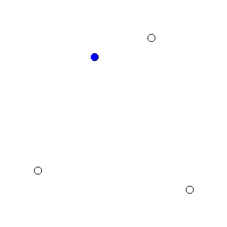

# catmullrom_anime
Animation generator for Catmull–Rom spline with tension parameter

[Wikipedia - Catmull-Romスプライン曲線](https://ja.wikipedia.org/wiki/Catmull-Rom%E3%82%B9%E3%83%97%E3%83%A9%E3%82%A4%E3%83%B3%E6%9B%B2%E7%B7%9A)<br>
[Wikipedia - Catmull–Rom spline](https://en.wikipedia.org/wiki/Catmull%E2%80%93Rom_spline)<br>

Wikipediaの上記ページで、Catmull-Romスプラインの3次エルミートスプライン表現の接ベクトル；<br>
$m_k = \frac{p_{k+1} - p_{k-1}}{2}$<br>
の係数 $1/2$ をテンションパラメータ $\tau$ に置き換えた；<br>
$m_k = \tau ( p_{k+1} - p_{k-1} )$<br>
について、以下の説明用アニメを掲載してあります。<br>
<br>

本リポジトリはこのアニメを作成するためのツール（Qtアプリ）と手順です。<br>

実行するとアニメーション表示され、各コマの画像 00.png～99.png が生成されます。<br>
これらをFFmpegでマージしてモーションGIFを作成しました。<br>

```
ffmpeg -i %02d.png -filter_complex "[0:v] fps=25,scale=320:-1,split [a][b];[a] palettegen [p];[b][p] paletteuse" output.gif
```

FFmpegを用いたモーションGIF作成については以下を参考にしました。<br>
[Qiita - ffmpegでとにかく綺麗なGIFを作りたい](https://qiita.com/yusuga/items/ba7b5c2cac3f2928f040)
